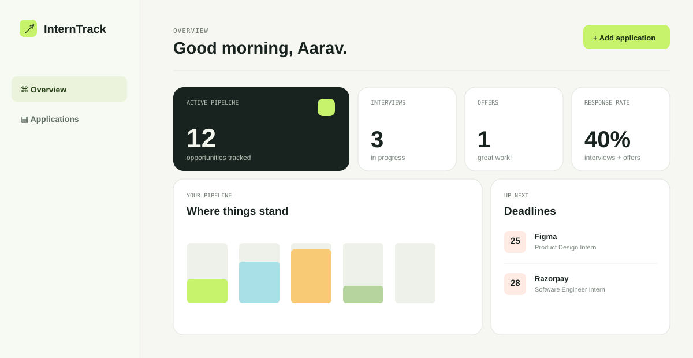

# InternTrack

InternTrack is a personal internship and job application command center. It helps applicants replace scattered spreadsheets and bookmarks with one focused workflow: save an opportunity, monitor deadlines, update its status, and record every follow-up.



## What it does

- Creates secure, individual accounts with hashed passwords and seven-day signed sessions.
- Tracks company, role, location, work style, status, application date, deadline, salary, job link, and notes.
- Gives every application an activity timeline for recruiter outreach, interview rounds, and reminders.
- Shows an at-a-glance pipeline, interview/offer count, response rate, upcoming deadlines, and recently updated applications.
- Includes server-side search and status filtering, responsive layouts, and graceful empty states.

## Stack

| Layer | Choice |
| --- | --- |
| Frontend | Semantic HTML, responsive CSS, vanilla JavaScript |
| Backend | Node.js and Express |
| Database | MongoDB using the official Node.js driver |
| Authentication | bcrypt password hashing and JWT bearer tokens |
| Hosting | Render Web Service + MongoDB Atlas |

## Run locally

### 1. Prerequisites

- Node.js 20 or newer
- MongoDB Community Edition running locally, or a hosted MongoDB Atlas connection string

### 2. Configure the app

```bash
npm install
Copy-Item .env.example .env
```

Update `.env` with your MongoDB connection string and a long, random `JWT_SECRET`. The database and indexes are created automatically. For example:

```env
MONGODB_URI=mongodb://127.0.0.1:27017/interntrack
JWT_SECRET=a-long-unique-random-value-at-least-16-characters
NODE_ENV=development
PORT=3000
```

### 3. Start it

```bash
npm start
```

Open `http://localhost:3000`. The server automatically creates the required database indexes on its first connection.

## Deploy on Render

InternTrack uses MongoDB Atlas for its managed database and Render for its Node web service. Create the Atlas database first:

1. In [MongoDB Atlas](https://www.mongodb.com/atlas), create a project and a free or paid cluster that fits your needs.
2. Under **Database Access**, create a dedicated database user with `readWrite` access. Save its password somewhere safe.
3. Under **Network Access**, allow the Render service to connect. For a student demo this commonly means allowing `0.0.0.0/0`; keep the database user password strong and never share the URI. Restrict this rule further for a production app.
4. On the cluster page choose **Connect → Drivers → Node.js**, then copy the `mongodb+srv://...` URI. Replace the password placeholder with the database user's password, URL-encoding any reserved characters. End the URI with `/interntrack` to use that database.

Atlas requires both an IP access-list entry and a database user for application connections. [MongoDB Atlas connection guide](https://www.mongodb.com/docs/atlas/driver-connection/)

Then deploy the application. The repository includes [`render.yaml`](render.yaml), so the fastest route is a Render Blueprint.

1. Push this repository to GitHub. Confirm that `.env` is **not** included in the commit.
2. In the [Render Dashboard](https://dashboard.render.com/), select **New → Blueprint** and connect the GitHub repository.
3. Render finds `render.yaml`. It creates the `interntrack` Node web service and prompts for the `MONGODB_URI` secret.
4. Paste the connection string from MongoDB Atlas, click **Apply**, and Render runs `npm install`, starts the app with `npm start`, and automatically generates the `JWT_SECRET` declared in the Blueprint.
5. Once the deploy is live, open the web service's `onrender.com` URL and create your own account. Test adding an application, an activity, and a deadline.

If you prefer to create the service manually, create a **Web Service** from the same repository and add the MongoDB Atlas connection string:

| Setting | Value |
| --- | --- |
| Runtime | Node |
| Build command | `npm install` |
| Start command | `npm start` |
| Health check path | `/api/health` |
| `NODE_ENV` | `production` |
| `MONGODB_URI` | MongoDB Atlas connection string for the `interntrack` database |
| `JWT_SECRET` | a new long random secret |

Do not paste the MongoDB connection string or `JWT_SECRET` into source code, screenshots, or the GitHub repository. The Blueprint uses `sync: false` so Render prompts for the database secret once during creation, and `generateValue: true` creates a random JWT secret. [Render Blueprint reference](https://render.com/docs/blueprint-spec)

## Submission checklist

- [ ] Push the finished repository to GitHub.
- [ ] Deploy with Render and paste the public URL into the submission form.
- [ ] Add the repository URL and deployed URL to the form.
- [ ] Record a short demo using the script below.
- [ ] Confirm no `.env`, database URL, JWT secret, or credentials appear in Git history.

## Two-minute demo script

1. Introduce the problem: internship searches become messy across spreadsheets, tabs, and notes.
2. Create an account and open the overview dashboard.
3. Add a new application with a deadline, job link, and notes.
4. Open it, add an activity such as “Recruiter contacted on LinkedIn,” then change the status to `Interview`.
5. Show how the dashboard updates its pipeline, interview count, response rate, and deadline card.
6. Navigate to Applications and demonstrate search plus status filtering.
7. Close by showing the mobile-responsive layout and the deployed Render URL.

## API overview

| Method | Endpoint | Purpose |
| --- | --- | --- |
| `POST` | `/api/auth/register` | Create an account |
| `POST` | `/api/auth/login` | Sign in |
| `GET` | `/api/dashboard` | Fetch dashboard metrics |
| `GET`, `POST` | `/api/applications` | List or create applications |
| `GET`, `PUT`, `DELETE` | `/api/applications/:id` | View, edit, or remove an application |
| `POST` | `/api/applications/:id/activities` | Add a timeline activity |

All application routes require `Authorization: Bearer <token>`.
